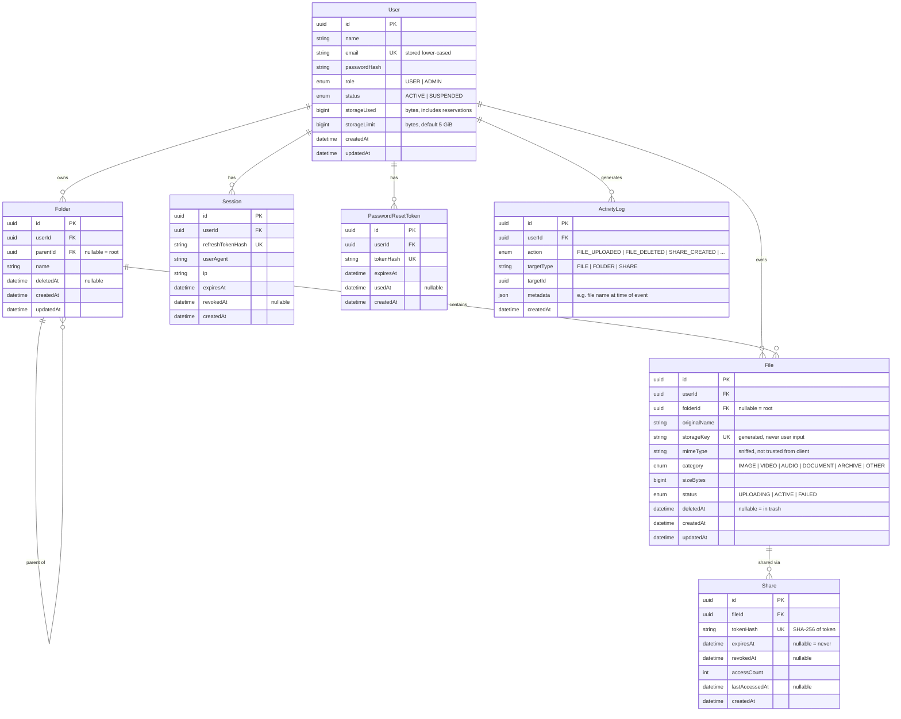
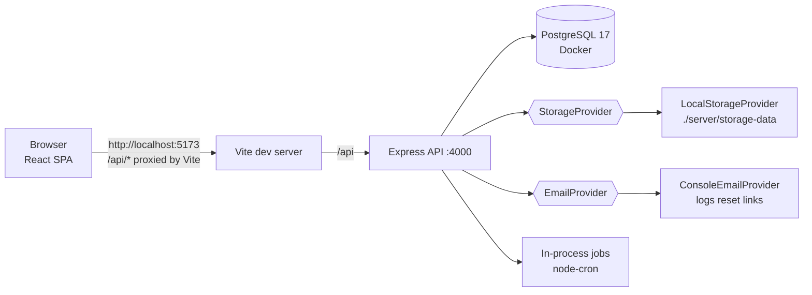
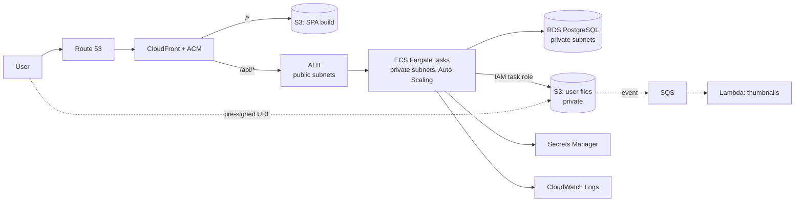

# CloudDrive — Phase 1: Planning & Architecture

> Status: **Plan confirmed. Phases 1–5 are built and committed.** Next: Phase 6.
> Plan written 2026-11-05 · Progress section last updated 2026-11-22

Contents

0. [Progress & how to continue](#0-progress--how-to-continue) ← **start here in a new session**
1. [Final requirements](#1-final-requirements)
2. [Feature breakdown](#2-feature-breakdown)
3. [Database design & ER diagram](#3-database-design--er-diagram)
4. [System architecture](#4-system-architecture)
5. [Key flows (upload, download, share, trash)](#5-key-flows)
6. [API design](#6-api-design)
7. [Frontend architecture & UI design](#7-frontend-architecture--ui-design)
8. [Security model](#8-security-model)
9. [Project structure](#9-project-structure)
10. [AWS mapping (local → cloud)](#10-aws-mapping-local--cloud)
11. [Development roadmap](#11-development-roadmap)
12. [Decisions needing your confirmation](#12-decisions-needing-your-confirmation)

---

## 0. Progress & how to continue

This section is the hand-off. A new session should read it first, then `README.md`
(setup, scripts, env vars, full API table), then the plan sections it points to.

### 0.1 Status by phase

| Phase                         | Status      | What exists                                                                                         |
| ----------------------------- | ----------- | --------------------------------------------------------------------------------------------------- |
| 1. Planning                   | ✅ Done     | This document                                                                                       |
| 2. Backend foundation         | ✅ Done     | Workspaces, Express 5, Prisma 7 + migrations, Docker Postgres, health checks, Vitest                |
| 3+4. Auth + frontend (merged) | ✅ Done     | Cookie JWT + rotating refresh sessions, CSRF, rate limits; React app, auth pages, landing, settings |
| 5A. Core backend (B1–B6)      | ✅ Done     | Storage layer, folders, uploads, file actions, trash + jobs, dashboard API                          |
| 5B. Core frontend (U1–U6)     | ✅ Done     | My Files, uploads, selection/menus/move/rename, preview/download, Trash page, dashboard             |
| **6. Sharing & admin**        | ⏭️ **Next** | Not started. See §5.3 (share flow), §6.2 (share + admin endpoints), §11 row 6                       |
| 7. Testing & optimisation     | Not started | §11 row 7                                                                                           |
| 8. AWS deployment             | Not started | §10, §11 row 8                                                                                      |

Tests at the end of Phase 5: **220 server + 143 client, all passing**; lint and Prettier clean.

### 0.2 Phase 5 steps and commits

| Step  | Commit    | Delivered                                                                                                                                              |
| ----- | --------- | ------------------------------------------------------------------------------------------------------------------------------------------------------ |
| B1+B2 | `54e89fb` | `StorageProvider` + local disk with HMAC-signed URLs (Range support); folders API with breadcrumbs, loop-safe move; ICU collation for name sorting     |
| B3    | `f7a9cc0` | Multer streaming upload, magic-byte type detection, atomic quota reservation, `UPLOADING → ACTIVE/FAILED`; file listing (search, filter, sort, paging) |
| B4    | `8755c4d` | File details, signed download links, rename/move, trash/restore, permanent delete (bytes first), bulk actions                                          |
| B5    | `6f215c4` | Folder trash/restore with shared subtree timestamp, trash page API, empty trash, in-process cleanup jobs                                               |
| B6    | `f3ba91b` | Dashboard stats (one transaction), recent files, activity feed (ID cursor); README API table                                                           |
| U1    | `42402ec` | RTK Query endpoints + cache tags; Dialog, DropdownMenu, Toaster, states, FileIcon                                                                      |
| U2    | `b53b43f` | My Files page: breadcrumbs, grid/list, sort, type filters, search, Load more; URL holds the state                                                      |
| U3    | `d3e23d7` | Upload queue (3 parallel, progress, real cancel), upload dialog, drag-and-drop, new folder; `GET /api/config`                                          |
| U4    | `e82d6a0` | Selection (click/Ctrl/Shift), toolbar, ⋯ + right-click menus, rename, move dialog, trash with Undo, shortcuts                                          |
| U5    | `d524958` | Preview (image, video, audio, PDF, text via Range), downloads; file-specific CSP on signed file responses                                              |
| U6    | `58ac72a` | Trash page, dashboard widgets, live sidebar storage meter                                                                                              |

### 0.3 Running it locally

```bash
docker compose up -d --wait   # Postgres: dev on 127.0.0.1:5434, test on 127.0.0.1:5433
npm run dev                   # API on :4000, web app on :5173 (Vite proxies /api)
npm test                      # all tests (server tests use the test DB on 5433)
```

- Port 5432 is taken by a native PostgreSQL 18 service on this machine; that's why dev uses **5434**.
- **Docker Desktop does not start by itself after a reboot.** If tests fail with
  `Can't reach database server at localhost:5433`, start Docker Desktop, then `docker compose up -d --wait`.
- `server/.env` holds real local secrets and is git-ignored; `server/.env.example` lists every variable.
- A local demo account exists in the dev database (its credentials are not stored in git).

### 0.4 How we work (the user's standing rules)

- Before each phase/step: inspect the workspace, show the plan (structure + steps), **wait for approval**.
- Build incrementally. For each step: explain the purpose, create files, explain important code,
  run tests, fix errors, then stop for approval. **Commit per step only when the user approves.**
- Explain concepts in **Hinglish** in replies; code comments stay in English.
- Production quality: security first, clean layers (routes → controllers → services → repositories).
- Every step ends with a deliberate **"break it" check**: disable the key guard, confirm a test fails, restore it.
- Don't overwrite files without reading them; never hard-code AWS credentials; never expose secrets to the frontend.
- Code lives on GitHub: `origin` = https://github.com/abhicse12/CloudDrive (Phases 1–5 pushed).
  Ask before pushing; the user often pushes from their own terminal.

### 0.5 Gotchas learned (save time)

- **Prisma `migrate dev` fails non-interactively.** Instead: `npx prisma migrate diff --from-config-datasource
--to-schema prisma/schema.prisma --script` into a new `prisma/migrations/<UTC timestamp>_<name>/migration.sql`,
  then `npx prisma migrate deploy`. CHECK constraints, partial/expression indexes, pg_trgm and ICU collation are hand-written SQL.
- **Don't start a second Vite/API server when the user's `npm run dev` is running.** Check ports 5173/4000 first and
  test against the running servers. A second Vite wiped the shared dep cache once (blank page, `504 Outdated Optimize Dep`;
  fix: restart `npm run dev`, hard refresh).
- In the Bash tool, scripts containing backticks or `${...}` get mangled; use the Edit tool for such changes.
- Zod 4: use `.prefault()` (not `.default()`) when the default must pass through a transform.
- React: `.jsx` files may only export components (react-refresh lint rule); helpers go in `.js` files.
- Client tests: `mockApi()` in `client/src/test-utils/renderWithApp.jsx` fakes the API and records params;
  jsdom lacks `<dialog>.showModal()`, stubbed in `test-utils/setup.js`.
- Concurrency tests must **force** the overlap (e.g. make storage wait until both requests arrive);
  otherwise they can pass by luck.

### 0.6 Known follow-ups (not bugs blocking Phase 6)

- Upload queue state isn't cleared on logout (uploads slice); harmless today, tidy up in Phase 7.
- Background jobs run inside the API process; with several servers they move to one scheduled task (Phase 8).
- Folder download (ZIP) is not supported; Download is offered for files only.
- The client-side quota pre-check can be slightly pessimistic near the limit (the server is authoritative).
- `publicShareLimiter` / `publicDownloadLimiter` (like every other limiter) use an in-memory store: with several
  API servers each counts separately. They need a shared store (Redis / ElastiCache) in Phase 8.

### 0.7 Where to continue: Phase 6 (Sharing & admin)

1. Inspect the workspace and read §5.3 (share links), the share/admin rows of §6.2, §7.2 (routes `/s/:token`,
   `/app/shared`, `/app/admin`) and §8 (security).
2. Propose a 6A (backend) / 6B (frontend) step plan like Phase 5 and **wait for approval** before coding.
3. The `Share` model, its indexes and the `SHARE_CREATED/REVOKED` activity actions already exist in the schema;
   the "Share" menu items are present but disabled ("Soon"), and Shared/Admin are greyed out in `navigation.js`.

---

## 1. Final requirements

### 1.1 Functional requirements

| Area      | Requirement                                                                                                                                                                                   |
| --------- | --------------------------------------------------------------------------------------------------------------------------------------------------------------------------------------------- |
| Accounts  | Register, log in, log out, view/update profile, change password, forgot/reset password (backend-ready; email sent via a pluggable provider that logs to the console locally).                 |
| Files     | Single and multiple upload with progress, size and type validation, download, inline preview (image, PDF, video, audio, text), rename, move, soft delete (trash), restore, permanent delete.  |
| Folders   | Create, rename, move, delete (to trash), restore, nested to any depth, breadcrumb navigation. Folder names unique per parent (case-insensitive).                                              |
| Browse    | Grid and list views; search by name; filter by category (image, video, audio, document, archive, other); sort by name, size, date; pagination.                                                |
| Sharing   | Read-only public links for **files**, optional expiry, revoke, copy link, list my shares, access counter. Public page reveals only that file's name, size, type and download button.          |
| Storage   | 5 GB default quota per user; used / remaining / percent; file count; usage by category. Uploads over quota rejected. Trash counts toward quota (like Google Drive) until permanently deleted. |
| Dashboard | Storage card, recent files, category breakdown, recent activity, quick upload.                                                                                                                |
| Admin     | Total users, files, storage; user list with search/pagination; change a user's role, quota, or suspend them.                                                                                  |
| Landing   | Hero, intro, features, how it works, plans (no payments), FAQ, footer.                                                                                                                        |

### 1.2 Non-functional requirements

| Concern       | Target                                                                                                                                             |
| ------------- | -------------------------------------------------------------------------------------------------------------------------------------------------- |
| Security      | OWASP-aligned: HttpOnly cookies, CSRF protection, rate limiting, Helmet, strict ownership checks, no secrets in the client, private storage.       |
| Portability   | Storage, email and job-queue behind interfaces → swap Local → S3 / SES / SQS via config only.                                                      |
| Statelessness | API servers keep no local state that matters (sessions in DB, files in a provider) → horizontally scalable behind an ALB later.                    |
| Consistency   | Quota and file metadata never drift from stored objects; failed uploads are rolled back; a cleanup job repairs anything left behind after a crash. |
| Observability | Structured JSON logs (pino) with request IDs → CloudWatch-ready. `/api/health` and `/api/health/ready` endpoints for load balancers.               |
| Config        | All config from environment variables, validated at startup with Zod (app refuses to boot with bad config).                                        |
| Quality       | ESLint + Prettier, Vitest + Supertest API tests against a real test database.                                                                      |
| UX            | Responsive (mobile → desktop), light + dark mode, loading / empty / error states everywhere.                                                       |

### 1.3 Out of scope (initially)

Real payments, file versioning, collaborative editing, sharing _folders_ publicly, sharing with specific users (invite to folder), virus scanning, server-side thumbnails. The schema leaves room for each; thumbnails and virus scanning are natural Phase 8 Lambda exercises.

---

## 2. Feature breakdown

Each epic lists the backend and frontend pieces it needs. The phase number shows when it's built.

| #   | Epic                | Backend                                                                                       | Frontend                                                                                          | Phase |
| --- | ------------------- | --------------------------------------------------------------------------------------------- | ------------------------------------------------------------------------------------------------- | ----- |
| E1  | Foundation          | Express app, config validation, Prisma, Docker Postgres, logger, error handler, health checks | —                                                                                                 | 2     |
| E2  | Auth                | Register, login, refresh, logout, me, CSRF, rate limits, `requireAuth`, `requireRole`         | —                                                                                                 | 3     |
| E3  | App shell           | —                                                                                             | Vite, Tailwind, router, layouts (public / auth / app), theme toggle, API client, protected routes | 4     |
| E4  | Auth UI             | Forgot/reset password endpoints                                                               | Login, register, forgot, reset pages with RHF + Zod, password toggle                              | 4     |
| E5  | Landing             | —                                                                                             | Landing page sections                                                                             | 4     |
| E6  | Folders             | CRUD, move with cycle check, breadcrumbs, soft delete subtree                                 | Folder grid, create/rename dialogs, breadcrumbs                                                   | 5     |
| E7  | Uploads             | Multer streaming, type sniffing, quota reservation, StorageProvider, status machine           | Upload dialog, drag & drop, per-file progress, cancel                                             | 5     |
| E8  | Browse              | List/search/filter/sort/paginate                                                              | Grid/list views, toolbar, context menu, multi-select                                              | 5     |
| E9  | Download & preview  | Signed URLs, range requests, safe content-disposition                                         | Preview modal (image/PDF/video/audio/text)                                                        | 5     |
| E10 | Trash               | Trash list, restore, permanent delete, empty trash, 30-day purge job                          | Trash page                                                                                        | 5     |
| E11 | Dashboard & storage | Stats, category usage, recent files, activity log                                             | Dashboard widgets                                                                                 | 5     |
| E12 | Settings            | Update profile, change password                                                               | Settings page                                                                                     | 5     |
| E13 | Sharing             | Create/list/revoke, public metadata + download                                                | Share dialog, Shared page, public `/s/:token` page                                                | 6     |
| E14 | Admin               | Stats, users list, update user                                                                | Admin dashboard                                                                                   | 6     |
| E15 | Hardening           | Tests (auth, ownership, quota, sharing), security review, indexes, query tuning               | Error boundaries, code splitting                                                                  | 7     |
| E16 | AWS                 | S3 provider, SES, Terraform, ECS/EC2, RDS, CloudFront…                                        | Build for CloudFront                                                                              | 8     |

---

## 3. Database design & ER diagram

### 3.1 ER diagram



### 3.2 Additions beyond the original spec, and why

| Addition                              | Reason                                                                                                                                                                                                |
| ------------------------------------- | ----------------------------------------------------------------------------------------------------------------------------------------------------------------------------------------------------- |
| `Session` model                       | A JWT can't be cancelled before it expires. Short-lived access tokens (15 min) plus a **refresh token stored hashed in the DB** make logout, "log out everywhere" and suspending users actually work. |
| `PasswordResetToken`                  | Forgot-password flow needs single-use, expiring tokens. Stored hashed, same pattern as shares.                                                                                                        |
| `ActivityLog`                         | Powers "Recent activity" on the dashboard and gives admins an audit trail (a local precursor to CloudTrail-style thinking).                                                                           |
| `File.category`                       | Computed from the MIME type at upload. Lets "usage by category" be one indexed `GROUP BY` instead of string-matching MIME types on every dashboard load.                                              |
| `Folder.deletedAt`                    | Deleting a folder must move its whole subtree to trash, not just its files.                                                                                                                           |
| `User.status`                         | Admin "user management" needs a way to suspend accounts.                                                                                                                                              |
| `Share.accessCount`, `lastAccessedAt` | Cheap and useful in the Shared Files page.                                                                                                                                                            |

### 3.3 Constraints, indexes and cascades

| Table                | Constraint / index                                                                                        | Why                                                                                                                                                                                               |
| -------------------- | --------------------------------------------------------------------------------------------------------- | ------------------------------------------------------------------------------------------------------------------------------------------------------------------------------------------------- |
| User                 | `UNIQUE(email)`                                                                                           | One account per email. Emails are lower-cased before saving.                                                                                                                                      |
| User                 | `CHECK (storage_used >= 0 AND storage_used <= storage_limit)`                                             | The database itself refuses to let quota go negative or over the limit, even if application code has a bug. Added via raw SQL in a migration (Prisma has no CHECK syntax).                        |
| Folder               | Partial unique index on `(user_id, COALESCE(parent_id, zero-uuid), lower(name)) WHERE deleted_at IS NULL` | No duplicate folder names in the same parent, ignoring case and ignoring trashed folders. Postgres treats `NULL`s as distinct, so `COALESCE` is needed for root-level folders. Raw SQL migration. |
| Folder               | `INDEX(user_id, parent_id)`                                                                               | Listing a folder's children.                                                                                                                                                                      |
| File                 | `UNIQUE(storage_key)`                                                                                     | One DB row per stored object.                                                                                                                                                                     |
| File                 | `INDEX(user_id, folder_id, deleted_at)`                                                                   | Listing folder contents (the hottest query).                                                                                                                                                      |
| File                 | `INDEX(user_id, deleted_at, created_at DESC)`                                                             | Recent files, trash.                                                                                                                                                                              |
| File                 | `INDEX(user_id, category)`                                                                                | Category filter and usage stats.                                                                                                                                                                  |
| File                 | GIN trigram index on `original_name` (`pg_trgm`)                                                          | Fast `ILIKE '%term%'` search. Raw SQL migration.                                                                                                                                                  |
| File                 | `INDEX(status, created_at)`                                                                               | Cleanup job finds stale `UPLOADING` rows.                                                                                                                                                         |
| Share                | `UNIQUE(token_hash)`, `INDEX(file_id)`                                                                    | Token lookup, list shares for a file.                                                                                                                                                             |
| Session / ResetToken | `UNIQUE(token_hash)`, `INDEX(user_id)`                                                                    | Token lookup, revoke all for a user.                                                                                                                                                              |

**Cascades** (all `ON DELETE CASCADE` from the parent): User → Folder, File, Session, ResetToken, ActivityLog; Folder → child Folder; File → Share.
`File.folderId` uses `ON DELETE SET NULL`: folders are only hard-deleted after their files are, so this is a safety net, not a normal path.

> Note: a DB cascade deletes **rows**, not the **objects** in storage. Hard deletes always go through a service that deletes objects first (or queues them for deletion). That's why we never rely on cascades to "clean up" files.

### 3.4 Data-type decisions

- **UUID primary keys** (`gen_random_uuid()`): IDs can't be guessed or enumerated (`/files/1`, `/files/2`…), and can be generated anywhere.
- **`BIGINT` for bytes**: 5 GiB = 5,368,709,120, which is larger than a 32-bit int. Prisma returns `BigInt`, which `JSON.stringify` can't handle, so the API serialises sizes as numbers (safe up to 9 PB).
- **`timestamptz`** for all dates, stored in UTC.

---

## 4. System architecture

### 4.1 Local development



**Why the Vite proxy matters:** the browser sees the SPA and the API on the **same origin** (`localhost:5173`). Cookies just work, CORS isn't needed in development, and this matches production, where CloudFront serves both `/` and `/api/*` from one domain.

### 4.2 Backend layers

```
HTTP request
   │
   ▼
routes/        → URL + method → middleware chain → controller
middleware/    → requestId, helmet, rate limit, auth, csrf, validate(zodSchema), upload
controllers/   → read validated input, call ONE service method, shape HTTP response. No business logic.
services/      → business rules: ownership, quota, state transitions, transactions
repositories/  → Prisma queries. EVERY query on user data takes userId.
storage/       → StorageProvider interface + Local / S3 implementations
jobs/          → cleanup of stale uploads, trash purge, expired sessions
```

**Rule:** controllers never import Prisma or `fs`; services never touch `req`/`res`. That keeps services testable and is exactly what lets S3 drop in later.

### 4.3 StorageProvider interface

```js
// server/src/storage/StorageProvider.js — the contract every provider implements
class StorageProvider {
  async upload({ key, sourcePath, contentType }) {} // move/upload a file into storage
  async download(key) {} // → readable stream (server-side use)
  async delete(key) {} // idempotent: deleting a missing key is OK
  async getSignedUrl(key, { expiresIn, disposition, filename, contentType }) {} // → time-limited URL
  async getMetadata(key) {} // → { size, contentType, lastModified } | null
}
```

| Method         | LocalStorageProvider                                                 | S3StorageProvider (Phase 8)    |
| -------------- | -------------------------------------------------------------------- | ------------------------------ |
| `upload`       | `fs.rename` temp → `storage-data/<key>`                              | `PutObject` / multipart upload |
| `download`     | `fs.createReadStream`                                                | `GetObject` body stream        |
| `delete`       | `fs.rm` with `force`                                                 | `DeleteObject`                 |
| `getSignedUrl` | HMAC-signed URL to `/api/storage/:key?exp=…&sig=…` served by our API | S3 pre-signed `GetObject` URL  |
| `getMetadata`  | `fs.stat`                                                            | `HeadObject`                   |

The local provider **imitates S3 pre-signed URLs** on purpose: the download flow ("check ownership → issue a short-lived signed URL → browser fetches it") is identical in both modes. When we switch to S3 you'll already understand pre-signed URLs, and nothing in the controllers or frontend changes.

Storage keys look like `users/<userId>/<fileUuid>`. They never contain the user's original filename (no path traversal, no special characters, no information leak).

### 4.4 Configuration

Every setting comes from environment variables, validated by a Zod schema in `server/src/config/env.js`. Examples: `DATABASE_URL`, `JWT_ACCESS_SECRET`, `STORAGE_DRIVER=local|s3`, `MAX_FILE_SIZE_MB`, `DEFAULT_STORAGE_LIMIT_BYTES`, `CORS_ORIGINS`. In AWS the same variables are injected from **Secrets Manager / Parameter Store** into the ECS task. The code doesn't change, only where the values come from.

---

## 5. Key flows

### 5.1 Upload with safe quota reservation

The problem: two uploads that each fit in the remaining quota can arrive at the same moment. If each one runs "read storageUsed → check → write", both pass and the user goes over quota. That's a **race condition**.

The fix: **reserve quota atomically in the database** with a single conditional update:

```sql
UPDATE users
SET storage_used = storage_used + $size
WHERE id = $userId AND status = 'ACTIVE' AND storage_used + $size <= storage_limit
RETURNING storage_used;
-- 0 rows updated → quota exceeded → 413
```

Postgres locks the row for that statement, so concurrent reservations are serialised. The `CHECK` constraint is the last line of defence.

```mermaid
sequenceDiagram
    autonumber
    participant C as Client
    participant API as Express
    participant DB as PostgreSQL
    participant S as StorageProvider
    C->>API: POST /api/files/upload (multipart, Content-Length)
    API->>DB: quick pre-check: Content-Length > remaining quota? → 413 early
    API->>API: Multer streams to temp dir (per-file size limit)
    API->>API: sniff magic bytes → real MIME, reject disallowed types
    API->>DB: TX: conditional UPDATE storage_used (+total)<br/>+ INSERT File rows status=UPLOADING
    alt quota exceeded
        API->>API: delete temp files
        API-->>C: 413 QUOTA_EXCEEDED
    end
    API->>S: upload(key, tempPath)
    alt storage succeeded
        API->>DB: UPDATE File status=ACTIVE, write ActivityLog
        API-->>C: 201 [file DTOs]
    else storage failed
        API->>DB: TX: status=FAILED, storage_used -= size
        API->>S: delete(key) (best-effort)
        API-->>C: 500 UPLOAD_FAILED for that file
    end
    Note over API,DB: Cleanup job (every 15 min): UPLOADING rows older than 1h →<br/>mark FAILED, release quota, delete object; remove orphaned temp files
```

**Why a status machine (`UPLOADING → ACTIVE | FAILED`)?** If the server crashes between steps 5 and 6, the row stays `UPLOADING` and the quota stays reserved. The cleanup job finds it and repairs it. Without the status we couldn't tell "in progress" from "abandoned". The same states support **direct-to-S3 uploads** in Phase 8 (reserve → client uploads straight to S3 with a pre-signed PUT → confirm), where the API never touches the bytes.

**Multi-file uploads:** each file is reserved and committed independently, so one bad file doesn't fail the batch. The response reports per-file results.

**Type validation:** the browser's `Content-Type` and the file extension are both easy to fake. We read the file's first bytes with the `file-type` library and check them against an allow-list (images, PDF, Office/ODF docs, text, audio, video, zip/7z/tar). Plain text formats (txt, csv, md, json) have no magic bytes, so they are validated separately.

### 5.2 Download & preview

1. `GET /api/files/:id/download?disposition=inline|attachment`
2. Service loads the file with `WHERE id = :id AND user_id = :me AND deleted_at IS NULL AND status = 'ACTIVE'`. If nothing matches → **404** (not 403: we don't reveal that someone else's file exists).
3. Provider returns a signed URL valid for 5 minutes → API responds `302` to it (or `200 { url }` for previews).
4. The signed URL serves the bytes with HTTP **Range** support, so videos can seek.

**XSS guard:** user-uploaded HTML/SVG/XML is always served as `attachment`, with `X-Content-Type-Options: nosniff` and a strict CSP. Otherwise an uploaded `.html` file could run scripts on our origin. In production, file bytes come from S3 or CloudFront on a **different origin**, which isolates them completely.

### 5.3 Share links

```
create:  token = randomBytes(32).toString('base64url')   → 256 bits of entropy
         store  sha256(token) in Share.tokenHash
         return https://app/s/<token> ONCE to the owner (we can't show it again)
access:  GET /api/public/shares/:token
         hash token → lookup → check: not revoked, not expired, file ACTIVE and not deleted,
         owner not suspended → return { name, size, mimeType } only
         GET /api/public/shares/:token/download → signed URL (attachment)
```

**Why SHA-256 here but bcrypt for passwords?** Passwords are low-entropy (people choose them), so we need a deliberately slow hash to resist guessing. Share tokens are 256 random bits; brute force is impossible anyway, and a fast deterministic hash lets us **look the token up by its hash** in an indexed column. If the database leaks, the attacker gets hashes, which aren't usable as links.

Invalid, expired and revoked tokens all return the same `404`, so an attacker learns nothing. Public routes get their own stricter rate limit and `Referrer-Policy: no-referrer`.

The link points to a frontend page (`/s/:token`), and the token stays in the path. The "copy link" UI only works right after creation, so the Shared page offers **"regenerate link"** (revoke + create) rather than re-showing old tokens.

### 5.4 Trash semantics

- **Delete a file** → `deletedAt = now()`. It disappears from listings, shares stop working, and it **still counts toward quota**.
- **Delete a folder** → in one transaction, set `deletedAt = T` (same timestamp) on the folder, all descendant folders, and all files in them that aren't already trashed. Descendants are found with a **recursive CTE**.
- **Trash view** shows only _top-level_ trashed items (items whose parent isn't trashed).
- **Restore a folder** → clear `deletedAt` on subtree items whose `deletedAt = T`. Items the user had deleted separately before that stay in trash, which is the correct behaviour. If the original parent no longer exists, restore to root. If the name now collides, append ` (restored)`.
- **Permanent delete** → delete storage objects, delete rows, decrement `storage_used` in one transaction (object deletion is retried by the job if it fails).
- **Auto-purge** job deletes items trashed more than 30 days ago.

---

## 6. API design

### 6.1 Conventions

- Base path `/api`, JSON, `camelCase` fields, ISO-8601 UTC dates, sizes in bytes.
- **Success:** `{ "success": true, "data": …, "meta": { … } }`
- **Error:**
  ```json
  { "success": false, "error": { "code": "QUOTA_EXCEEDED", "message": "Not enough storage space.", "details": [ … ] }, "requestId": "…" }
  ```
- **Pagination:** `?page=1&pageSize=50` (max 100) → `meta: { page, pageSize, total, totalPages }`. Offset pagination is simple and fine at this scale; cursor pagination can come later if needed.
- **Sorting:** `?sortBy=name|size|createdAt&sortOrder=asc|desc`
- **Auth:** HttpOnly cookies. Every non-GET request must send header `X-CSRF-Token` (see §8).
- **Status codes:** 200, 201, 204, 302, 400 (validation), 401 (not logged in), 403 (logged in but wrong role/suspended or bad CSRF), 404 (missing **or not yours**), 409 (name conflict), 413 (file too large / quota), 415 (type not allowed), 429 (rate limited), 500.

### 6.2 Endpoints

Legend: 🔓 public · 🔐 logged-in · 👑 admin · ⏱ rate-limited · ✳ added to the original spec

**Health**

| Method | Path                     | Description                                                            |
| ------ | ------------------------ | ---------------------------------------------------------------------- |
| GET    | `/api/health` 🔓         | Liveness: process is up.                                               |
| GET    | `/api/health/ready` 🔓 ✳ | Readiness: DB reachable, storage writable. ALB target groups use this. |

**Auth**

| Method | Path                              | Body / query                       | Response                                                |
| ------ | --------------------------------- | ---------------------------------- | ------------------------------------------------------- |
| GET    | `/api/auth/csrf` 🔓 ✳             | —                                  | Sets CSRF cookie, returns `{ csrfToken }`               |
| POST   | `/api/auth/register` 🔓⏱          | `{ name, email, password }`        | 201 `{ user }` + auth cookies                           |
| POST   | `/api/auth/login` 🔓⏱             | `{ email, password }`              | 200 `{ user }` + auth cookies                           |
| POST   | `/api/auth/refresh` 🔓⏱ ✳         | refresh cookie                     | 200, rotates both cookies                               |
| POST   | `/api/auth/logout` 🔐             | —                                  | 204, revokes session, clears cookies                    |
| GET    | `/api/auth/me` 🔐                 | —                                  | `{ user }` incl. storage summary                        |
| PATCH  | `/api/auth/me` 🔐 ✳               | `{ name }`                         | `{ user }`                                              |
| POST   | `/api/auth/change-password` 🔐⏱ ✳ | `{ currentPassword, newPassword }` | 204, revokes other sessions                             |
| POST   | `/api/auth/forgot-password` 🔓⏱ ✳ | `{ email }`                        | Always 202, so it never reveals whether an email exists |
| POST   | `/api/auth/reset-password` 🔓⏱ ✳  | `{ token, newPassword }`           | 204, revokes all sessions                               |

**Files**

| Method | Path                          | Body / query                                                                                             | Notes                                                                                          |
| ------ | ----------------------------- | -------------------------------------------------------------------------------------------------------- | ---------------------------------------------------------------------------------------------- |
| GET    | `/api/files` 🔐               | `folderId` (omit = root, `all` = everywhere), `q`, `category`, `sortBy`, `sortOrder`, `page`, `pageSize` | Active, non-trashed files                                                                      |
| POST   | `/api/files/upload` 🔐⏱       | multipart: `files[]` (≤ 20), `folderId?`                                                                 | 201 per-file results                                                                           |
| GET    | `/api/files/:id` 🔐           | —                                                                                                        | File DTO + folder path                                                                         |
| GET    | `/api/files/:id/download` 🔐  | `disposition=attachment\|inline`, `redirect=true\|false`                                                 | 302 to signed URL or `{ url, expiresAt }`                                                      |
| PATCH  | `/api/files/:id` 🔐           | `{ name?, folderId? }`                                                                                   | Rename and/or move                                                                             |
| DELETE | `/api/files/:id` 🔐           | —                                                                                                        | Move to trash, 204                                                                             |
| POST   | `/api/files/:id/restore` 🔐   | —                                                                                                        | Restore from trash                                                                             |
| DELETE | `/api/files/:id/permanent` 🔐 | —                                                                                                        | Must already be in trash, 204                                                                  |
| POST   | `/api/files/bulk` 🔐 ✳        | `{ action: trash\|restore\|move\|delete, ids[], folderId? }`                                             | Multi-select actions                                                                           |
| GET    | `/api/storage/:key` 🔓 ✳      | `exp`, `sig`, `disp`                                                                                     | **Local provider only.** Serves bytes when the HMAC signature is valid. Removed when using S3. |

**Folders**

| Method | Path                              | Body / query                                    | Notes                                                           |
| ------ | --------------------------------- | ----------------------------------------------- | --------------------------------------------------------------- |
| GET    | `/api/folders` 🔐                 | `parentId` (omit = root), `sortBy`, `sortOrder` | Child folders                                                   |
| POST   | `/api/folders` 🔐                 | `{ name, parentId? }`                           | 409 on duplicate name                                           |
| GET    | `/api/folders/:id` 🔐             | —                                               | `{ folder, breadcrumbs: [{id,name}…] }`                         |
| PATCH  | `/api/folders/:id` 🔐             | `{ name?, parentId? }`                          | Move rejects cycles (moving into own descendant)                |
| DELETE | `/api/folders/:id` 🔐             | —                                               | Trash folder subtree                                            |
| POST   | `/api/folders/:id/restore` 🔐 ✳   | —                                               | Restore subtree                                                 |
| DELETE | `/api/folders/:id/permanent` 🔐 ✳ | —                                               | Delete subtree + objects                                        |
| GET    | `/api/folders/tree` 🔐 ✳          | —                                               | Lightweight `{id,name,parentId}` list for the "Move to…" picker |

**Trash** ✳

| Method | Path            | Notes                                                               |
| ------ | --------------- | ------------------------------------------------------------------- |
| GET    | `/api/trash` 🔐 | Top-level trashed files and folders, with `deletedAt` and `purgeAt` |
| DELETE | `/api/trash` 🔐 | Empty trash                                                         |

**Sharing**

| Method | Path                                       | Body / query                                                          | Notes                                                    |
| ------ | ------------------------------------------ | --------------------------------------------------------------------- | -------------------------------------------------------- |
| POST   | `/api/files/:id/share` 🔐                  | `{ expiresAt? }` or `{ expiresIn: "1h"\|"1d"\|"7d"\|"30d"\|"never" }` | 201 `{ share, url }`; URL shown once                     |
| GET    | `/api/shares` 🔐                           | `status=active\|expired\|revoked`, pagination                         | My shares with file info                                 |
| GET    | `/api/shares/:id` 🔐                       | —                                                                     | One share (no token)                                     |
| DELETE | `/api/shares/:id` 🔐                       | —                                                                     | Revoke (sets `revokedAt`), 204                           |
| GET    | `/api/public/shares/:token` 🔓⏱            | —                                                                     | `{ fileName, sizeBytes, mimeType, category, expiresAt }` |
| GET    | `/api/public/shares/:token/download` 🔓⏱ ✳ | `disposition`                                                         | 302 to signed URL, increments `accessCount`              |

**Dashboard**

| Method | Path                             | Response                                                                                                                            |
| ------ | -------------------------------- | ----------------------------------------------------------------------------------------------------------------------------------- |
| GET    | `/api/dashboard/stats` 🔐        | `{ storageUsed, storageLimit, remaining, percentUsed, fileCount, folderCount, byCategory: [{category, count, bytes}], trashBytes }` |
| GET    | `/api/dashboard/recent-files` 🔐 | `?limit=8` → files                                                                                                                  |
| GET    | `/api/dashboard/activity` 🔐 ✳   | `?limit=10` → activity entries                                                                                                      |

**Admin**

| Method | Path                        | Notes                                                                          |
| ------ | --------------------------- | ------------------------------------------------------------------------------ |
| GET    | `/api/admin/stats` 👑       | Totals, signups over the last 30 days, storage by category, top users by usage |
| GET    | `/api/admin/users` 👑       | `q`, `role`, `status`, sort, pagination                                        |
| PATCH  | `/api/admin/users/:id` 👑 ✳ | `{ role?, status?, storageLimit? }`; admins can't demote or suspend themselves |

### 6.3 Example DTO

```json
{
  "id": "0b8f…",
  "name": "Specification.pdf",
  "mimeType": "application/pdf",
  "category": "DOCUMENT",
  "sizeBytes": 482113,
  "folderId": null,
  "createdAt": "2026-11-05T10:12:00.000Z",
  "updatedAt": "2026-11-05T10:12:00.000Z",
  "isShared": true
}
```

`storageKey`, `userId` and `status` internals are **never** included in API responses.

---

## 7. Frontend architecture & UI design

### 7.1 State management

| Kind of state                   | Tool                                                                    | Examples                                                                     |
| ------------------------------- | ----------------------------------------------------------------------- | ---------------------------------------------------------------------------- |
| Server data (cached, refetched) | **RTK Query** (part of Redux Toolkit), using an Axios-based `baseQuery` | files, folders, shares, stats                                                |
| Global client state             | Redux Toolkit slices                                                    | current user, upload queue + progress, view mode (grid/list), selection      |
| Local UI state                  | `useState`                                                              | open dialogs, hover                                                          |
| URL state                       | React Router search params                                              | current folder, `q`, `category`, `sortBy`, so links and the back button work |
| Theme                           | Context + `localStorage`                                                | light/dark                                                                   |

Why RTK Query: it is part of the required Redux Toolkit stack, removes hand-written loading/error/caching code, and **tag invalidation** means uploading a file automatically refreshes the file list and the storage card. Uploads use Axios directly because we need `onUploadProgress` and `AbortController` for cancelling.

### 7.2 Routes

```
/                      Landing                      (public layout)
/login /register       Auth pages                   (auth layout; redirect to /app if logged in)
/forgot-password
/reset-password?token=
/s/:token              Public share page            (minimal layout)
/app                   Dashboard                    (app layout, protected)
/app/files             My Files (root)
/app/folders/:id       Folder view with breadcrumbs
/app/shared            Shared links
/app/trash             Trash
/app/settings          Profile, password, storage
/app/admin             Admin dashboard               (ADMIN only)
*                      404
```

Pages are lazy-loaded with `React.lazy`, so the landing page doesn't download the dashboard code.

### 7.3 Visual design (from your reference images)

The references are design inspiration only. CloudDrive gets its own identity (name, logo, indigo/violet palette), not a copy of pCloud's look.

| Reference          | What we take from it                                                                                                                                                                                                                                                                                                                                                                                                                                                                                   |
| ------------------ | ------------------------------------------------------------------------------------------------------------------------------------------------------------------------------------------------------------------------------------------------------------------------------------------------------------------------------------------------------------------------------------------------------------------------------------------------------------------------------------------------------ |
| pCloud dashboard   | Slim **icon rail sidebar** that expands to labels on desktop; top bar with page title, prominent **"New" button** (dropdown: upload files, new folder), search, notifications, avatar. Folders as compact **pill cards** above a **file grid of large type icons**. A **selection toolbar** replaces the filter bar when items are selected ("1 selected · Share · Download · Move · ⋯"). **Right-click / ⋯ context menu** with a nested Share submenu. Grid/list toggle + sort dropdown on the right. |
| File upload dialog | **Dashed dropzone** with cloud icon, "Drag & drop or Browse files", and a **per-file list with type icon, size, progress bar, ✓ / ✕** (✕ cancels in-flight, removes finished). We also allow dropping files anywhere on the files page.                                                                                                                                                                                                                                                                |
| Dark sign-up       | **Split-screen auth**: left image/gradient panel with tagline and carousel dots, right form card. Two-column first/last name → we'll use a single "Full name" field (the model has `name`). Social login buttons are left out until OAuth exists, so the UI doesn't show buttons that don't work.                                                                                                                                                                                                      |

Design tokens (Tailwind v4 `@theme`): primary indigo-600 / violet-500 accents, slate neutrals, `rounded-xl` cards, soft shadows, glass (`backdrop-blur`, translucent white) **only** on the top bar, dialogs and the auth panel. Font: Inter. Dark mode via a `.dark` class with matching tokens. Motion: 150–200 ms transitions on hover/menus, respecting `prefers-reduced-motion`.

Responsive: below `md`, the sidebar becomes a drawer, the grid drops to 2 columns, and the context menu becomes a bottom sheet.

### 7.4 Shared components

`Button`, `Input`, `PasswordInput`, `Dialog`, `DropdownMenu`, `ContextMenu`, `Toast`, `Skeleton`, `EmptyState`, `ErrorState`, `FileIcon` (category → Lucide icon + colour), `FileCard`, `FileRow`, `FolderCard`, `Breadcrumbs`, `StorageMeter`, `UploadDialog`, `PreviewModal`, `ShareDialog`, `MoveDialog`, `ConfirmDialog`.

---

## 8. Security model

| Threat                                | Mitigation                                                                                                                                                                                                                                     |
| ------------------------------------- | ---------------------------------------------------------------------------------------------------------------------------------------------------------------------------------------------------------------------------------------------- |
| Password theft from DB leak           | bcrypt with cost factor 12. Passwords: at least 8 characters, a maximum length (bcrypt truncates at 72 bytes), and checks against common weak passwords.                                                                                       |
| Token theft via XSS                   | Access and refresh tokens live in **HttpOnly** cookies, which JavaScript can't read. CSP via Helmet. React escapes output by default.                                                                                                          |
| CSRF (cookies are sent automatically) | `SameSite=Lax` cookies **plus** a double-submit token: the server sets a readable `csrf` cookie, and Axios copies it into an `X-CSRF-Token` header on every non-GET request. Another site can't read our cookie, so it can't forge the header. |
| Session hijack / logout not working   | 15-min access JWT + 7-day refresh token, **rotated on every refresh** and stored hashed. If an already-used refresh token is presented again, that session is revoked (reuse detection).                                                       |
| Brute-force login                     | `express-rate-limit`: login 10 per 15 min per IP+email, register 5 per hour per IP, password reset 5 per hour. Same error message for "no such user" and "wrong password".                                                                     |
| IDOR (changing IDs in requests)       | Every repository query includes `userId` from the verified JWT, never from the request body. Foreign IDs (e.g. `folderId` when moving) are ownership-checked too. Covered by dedicated tests in Phase 7.                                       |
| Path traversal                        | Generated storage keys. The local provider resolves paths and checks they stay inside the storage root.                                                                                                                                        |
| Malicious uploads                     | Size limits, magic-byte type checks, allow-list, `attachment` for active content, `nosniff`. Separate origin for file bytes in production.                                                                                                     |
| Quota abuse / races                   | Atomic conditional update + DB `CHECK` constraint + cleanup job.                                                                                                                                                                               |
| Info leaks                            | 404 for other users' resources. Error responses never include stack traces outside development. DTOs whitelist their fields.                                                                                                                   |
| Secret exposure                       | Secrets only in server env vars. `.env` is git-ignored and only `.env.example` is committed. Secrets Manager in AWS.                                                                                                                           |
| Header hardening                      | Helmet (CSP, HSTS in production, frameguard, noSniff), `x-powered-by` disabled, CORS allow-list from env.                                                                                                                                      |

`Secure` cookies require HTTPS. They're turned on via `COOKIE_SECURE=true` in production (ACM certificate on the ALB/CloudFront) and off for `http://localhost`.

---

## 9. Project structure

The original structure, with three changes:

- an npm-workspaces root so `npm run dev` starts everything
- `docker-compose.yml` for Postgres
- `client/src/features/` organised **by feature** (each feature holds its API slice, components and hooks)

```
clouddrive/
├── package.json                 # npm workspaces + root scripts (dev, lint, test)
├── docker-compose.yml           # postgres:17 (+ separate test DB)
├── .editorconfig  .prettierrc  eslint.config.js  .gitignore
├── README.md
├── docs/
│   ├── PHASE-1-PLAN.md          # this file
│   ├── API.md                   # generated/maintained in Phase 7
│   └── postman/                 # Postman collection + environment
├── client/
│   ├── index.html  vite.config.js  package.json  .env.example
│   └── src/
│       ├── main.jsx  App.jsx  router.jsx  index.css
│       ├── assets/
│       ├── components/ui/       # Button, Dialog, Input, Toast…
│       ├── components/common/   # FileIcon, StorageMeter, EmptyState…
│       ├── layouts/             # PublicLayout, AuthLayout, AppLayout
│       ├── features/
│       │   ├── auth/            # authApi.js, authSlice.js, LoginForm.jsx, schemas.js
│       │   ├── files/           # filesApi.js, FileGrid.jsx, FileContextMenu.jsx…
│       │   ├── folders/
│       │   ├── uploads/         # uploadSlice.js, UploadDialog.jsx, useUpload.js
│       │   ├── sharing/
│       │   ├── trash/
│       │   ├── dashboard/
│       │   └── admin/
│       ├── pages/               # thin route components composing features
│       ├── hooks/               # useDebounce, useTheme, useMediaQuery
│       ├── services/            # axios instance (CSRF header, refresh-on-401), baseApi.js
│       ├── store/               # configureStore
│       └── utils/               # formatBytes, formatDate, fileCategory
└── server/
    ├── package.json  .env.example  vitest.config.js
    ├── prisma/
    │   ├── schema.prisma
    │   ├── migrations/
    │   └── seed.js              # admin user + demo data
    ├── storage-data/            # local file storage (git-ignored)
    ├── tmp-uploads/             # multer temp dir (git-ignored)
    ├── tests/                   # auth, ownership, quota, upload, sharing
    └── src/
        ├── app.js               # builds the Express app (no listen → testable)
        ├── server.js            # listen + graceful shutdown + start jobs
        ├── config/              # env.js (Zod), prisma.js, logger.js, constants.js
        ├── routes/              # index.js + one router per resource
        ├── controllers/
        ├── services/            # auth, file, folder, upload, share, quota, trash, dashboard, admin, activity
        ├── repositories/        # user, file, folder, share, session
        ├── middleware/          # auth, requireRole, csrf, rateLimits, validate, upload, errorHandler, requestId
        ├── validators/          # Zod schemas per resource
        ├── storage/             # StorageProvider.js, LocalStorageProvider.js, index.js (factory by env)
        ├── email/               # EmailProvider + ConsoleEmailProvider (SES later)
        ├── jobs/                # cleanupStaleUploads, purgeTrash, purgeSessions, scheduler.js
        └── utils/               # AppError, asyncHandler, tokens, mime/category, pagination, dto
```

**Module system:** ES modules (`"type": "module"`) on both sides. It's the modern standard, and current versions of key libraries (e.g. `file-type`) are ESM-only.

**Planned versions** (to be confirmed against the npm registry at the start of Phase 2): Node 24 LTS (you have 24.12), Express 5 (handles errors thrown in `async` handlers natively), Prisma (latest stable), PostgreSQL 17, React 19, Vite (latest), Tailwind CSS v4, React Router 7, Redux Toolkit 2, Zod 4, Vitest + Supertest.

---

## 10. AWS mapping (local → cloud)

Everything we build locally has a direct AWS counterpart. That's what "AWS-ready" means here.

| Local component                  | AWS service                                                                                                              | What changes in our code                                     |
| -------------------------------- | ------------------------------------------------------------------------------------------------------------------------ | ------------------------------------------------------------ |
| `LocalStorageProvider`           | **S3** private bucket (Block Public Access on, SSE encryption)                                                           | New `S3StorageProvider` + `STORAGE_DRIVER=s3`. Nothing else. |
| HMAC signed local URLs           | **S3 pre-signed URLs**, optionally via **CloudFront signed URLs**                                                        | None (same interface)                                        |
| Docker Postgres                  | **RDS PostgreSQL** in private subnets, Multi-AZ                                                                          | `DATABASE_URL` only                                          |
| `.env` file                      | **Secrets Manager** / SSM Parameter Store                                                                                | None; values are injected as env vars                        |
| `node server.js`                 | Docker image in **ECR** → **ECS Fargate** (or **EC2** + **Auto Scaling Group**)                                          | Add a `Dockerfile`                                           |
| Vite proxy (same origin)         | **CloudFront**: `/` → S3 (SPA build), `/api/*` → **ALB**                                                                 | None                                                         |
| `localhost`                      | **Route 53** domain + **ACM** certificate (HTTPS)                                                                        | `COOKIE_SECURE=true`, CORS origins                           |
| Network                          | **VPC**: public subnets (ALB, NAT), private subnets (app, RDS); **Security Groups**: ALB → app:4000, app → RDS:5432 only | None                                                         |
| Credentials                      | **IAM role** for the ECS task with least-privilege S3 access to its bucket only. No access keys anywhere.                | AWS SDK picks up the role automatically                      |
| pino JSON logs                   | **CloudWatch Logs** + metrics/alarms on 5xx, latency, DB CPU                                                             | None                                                         |
| node-cron jobs                   | **EventBridge Scheduler** → **Lambda** or ECS scheduled task                                                             | Job functions are already standalone                         |
| (future) thumbnails / virus scan | S3 event → **SQS** → **Lambda**                                                                                          | New Lambda; `File` gets `thumbnailKey`                       |
| `ConsoleEmailProvider`           | **SES** for email (SNS for admin alerts)                                                                                 | New provider class                                           |
| —                                | **CloudTrail** for auditing AWS API calls                                                                                | None                                                         |
| Click-ops                        | **Terraform** modules for all of the above                                                                               | New `infra/` folder                                          |



---

## 11. Development roadmap

Each phase ends with a **verification checklist**. We don't move on until it passes.

| Phase                         | Deliverables                                                                                                                                                                                                                                                                          | Verified by                                                                                                                                            |
| ----------------------------- | ------------------------------------------------------------------------------------------------------------------------------------------------------------------------------------------------------------------------------------------------------------------------------------- | ------------------------------------------------------------------------------------------------------------------------------------------------------ |
| **1. Planning**               | This document                                                                                                                                                                                                                                                                         | Your confirmation of §12                                                                                                                               |
| **2. Backend foundation**     | git init, workspaces, ESLint/Prettier, docker-compose Postgres, Express 5 app (helmet, cors, pino, requestId, error handler, 404), Zod env config, Prisma schema for **all** models + raw-SQL migration (CHECK, partial unique, pg_trgm), seed script, health endpoints, Vitest setup | `docker compose up`, `npx prisma migrate dev` applies cleanly, `GET /api/health/ready` → 200 with DB ok, first test passes, Prisma Studio shows tables |
| **3. Authentication**         | Register/login/refresh/logout/me, bcrypt, JWT cookies, session rotation, CSRF, rate limits, `requireAuth`/`requireRole`, Zod validators, profile + change-password + forgot/reset endpoints                                                                                           | Postman collection flows; tests: register → login → me; bad password; refresh rotation + reuse detection; CSRF rejection; 429 on brute force           |
| **4. Frontend foundation**    | Vite + React + Tailwind v4, tokens + dark mode, router, layouts, API client (CSRF + auto-refresh), Redux store, protected/admin routes, login/register/forgot/reset pages, landing page                                                                                               | Register and log in from the browser; refresh the page and stay logged in; logout; route guards redirect correctly; responsive check                   |
| **5. Core features**          | StorageProvider + Local, upload pipeline with quota reservation, folders (CRUD, move, breadcrumbs), files list/search/filter/sort, download & preview, trash & jobs, dashboard, settings                                                                                              | Upload many files with progress; quota rejection; nested folders; move; preview each type; trash/restore/purge; dashboard numbers match DB             |
| **6. Sharing & admin**        | Share create/list/revoke/expire, public page, admin stats/users/update                                                                                                                                                                                                                | Open a link in a private window; expired/revoked → 404; trashed file → 404; non-admin → 403                                                            |
| **7. Testing & optimisation** | Full API test suite (auth, ownership/IDOR, quota concurrency, sharing, uploads), security review, EXPLAIN on hot queries, code splitting, README + API docs + Postman                                                                                                                 | `npm test` green; coverage report; concurrent-upload test never exceeds quota                                                                          |
| **8. AWS deployment**         | Dockerfile, S3StorageProvider, SES provider, Terraform (VPC, SGs, RDS, S3, ECR/ECS, ALB, CloudFront, Route 53, ACM, IAM, CloudWatch, Secrets Manager), CI/CD (GitHub Actions)                                                                                                         | App reachable over HTTPS on your domain; files land in a private S3 bucket; logs in CloudWatch                                                         |

Phase 8 is split into small sub-steps (IAM → S3 → VPC → RDS → compute → CloudFront → monitoring), each explained in turn, because it's the main learning part. Note that AWS resources cost money; we'll use free-tier sizes and include `terraform destroy` instructions.

---

## 12. Decisions needing your confirmation

| #   | Decision                         | Recommendation                                                                                                    | Alternative                                                                                   |
| --- | -------------------------------- | ----------------------------------------------------------------------------------------------------------------- | --------------------------------------------------------------------------------------------- |
| D1  | Auth tokens                      | **HttpOnly cookie access JWT (15 min) + rotating refresh token stored in a `Session` table** + double-submit CSRF | Single long-lived JWT (simpler, but logout and suspension can't take effect immediately)      |
| D2  | Extra models                     | **Add `Session`, `PasswordResetToken`, `ActivityLog`; add `category`, `Folder.deletedAt`, `User.status`**         | Strict original 4 models (loses refresh tokens, reset flow, activity feed, folder trash)      |
| D3  | Server-state management          | **RTK Query (Redux Toolkit) + Axios for uploads**                                                                 | Plain Redux thunks + Axios, or TanStack Query (outside the listed stack)                      |
| D4  | Local downloads                  | **HMAC-signed URLs that imitate S3 pre-signed URLs**                                                              | Stream bytes directly through the authenticated endpoint (simpler now, more to change for S3) |
| D5  | Trash & quota                    | **Trashed files still count toward quota; auto-purge after 30 days**                                              | Release quota on soft delete                                                                  |
| D6  | Duplicate file names in a folder | **Allowed** (like Google Drive; files are identified by ID)                                                       | Auto-rename to `name (1).ext`, or reject with 409                                             |
| D7  | Database locally                 | **PostgreSQL 17 in Docker Compose** (you have Docker; no local `psql` installed)                                  | Native Windows PostgreSQL install                                                             |
| D8  | Max upload size                  | **100 MB per file, 20 files per request** (configurable via env)                                                  | Higher limits will need direct-to-S3 uploads, planned for Phase 8                             |
| D9  | Sign-up form                     | **Single "Full name" field**, no social buttons until OAuth exists                                                | First/last name fields like the reference                                                     |
